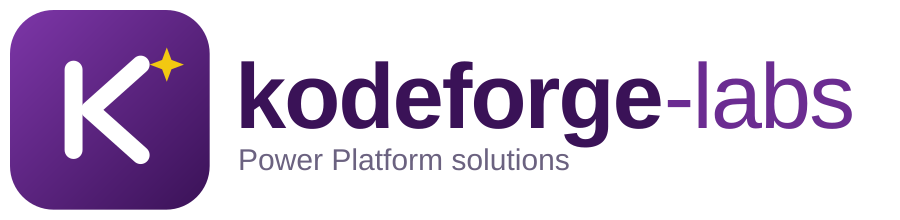

  

# Hi, I'm Aquib Javed 👋

**Power Platform Developer** building business apps, automations and dashboards that save teams time.

🌐 **Portfolio:** [kodeforge-labs.github.io](https://kodeforge-labs.github.io)
📫 **Contact:** akibjaved413@gmail.com
📍 **Location:** Khulna, Bangladesh · Open to remote work

---

## 🔧 What I work with

- **Power Apps:** canvas and model-driven apps, Power Fx, component libraries
- **Power Automate:** cloud flows, approvals, desktop flows (RPA), custom connectors
- **Power BI:** data modelling, DAX, Power Query, row-level security
- **Dataverse and SharePoint:** tables, security roles, lists, document libraries
- **ALM and governance:** solutions, environments, DLP policies, Azure DevOps / GitHub

## 🚀 Featured projects

| Project | What it does | Tools |
|---|---|---|
| **Leave Request App** | Staff request leave, managers approve in Teams | Power Apps, Dataverse, Power Automate |
| **Sales Performance Dashboard** | KPI report with row-level security and scheduled refresh | Power BI, DAX, Power Query |
| **Invoice Approval Workflow** | Routes invoices from SharePoint for approval and logs results | Power Automate, SharePoint |
| **Asset Tracker** | Model-driven app for managing IT equipment | Dataverse, Model-driven apps |

> Replace these rows with your own projects and link each name to its repository.

## 📜 Certifications

PL-900 · PL-200 · PL-300 · PL-400 *(keep only the ones you hold)*

## 🌱 Currently

- 🔭 Working on: [your current project]
- 🌱 Learning: [e.g. PCF controls, Copilot Studio, Fabric]
- 💬 Ask me about: Power Apps, Power Automate, Power BI, Dataverse

## 📫 Let's connect

